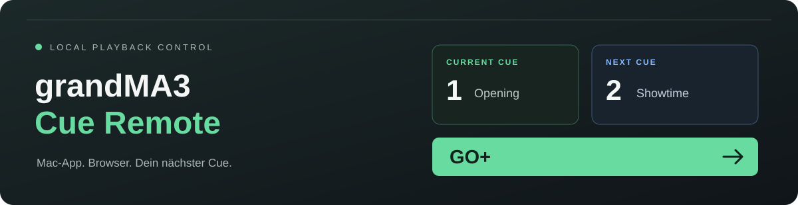

<div align="center">



**Deine Cueliste. Dein GO. Direkt im Browser.**

Lokale Sequenz-Fernbedienung für grandMA3 mit einer Mac-App als Server und einer kompakten Weboberfläche für Tablet und Desktop.

[](https://github.com/Wiwaltill/grandMA3-Cue-Remote/releases/tag/v0.2.11)
[](https://github.com/Wiwaltill/grandMA3-Cue-Remote/releases/tag/v0.2.11)
[](#voraussetzungen)
[](https://github.com/Wiwaltill/grandMA3-Cue-Remote/actions/workflows/ci.yml)
[](LICENSE)

**[Mac-App herunterladen](https://github.com/Wiwaltill/grandMA3-Cue-Remote/releases/download/v0.2.11/MA3-Cue-Remote-v0.2.11-macOS-arm64.zip)** · [Release Notes](https://github.com/Wiwaltill/grandMA3-Cue-Remote/releases/tag/v0.2.11) · [Ausführliche Einrichtung](docs/SETUP.md)

</div>

## Was die App kann

| Funktion | Im Betrieb |
| --- | --- |
| **Current & Next** | Große Cue-Nummern, Namen und Zeiten. Next zeigt immer den nächsten Eintrag der Cueliste. |
| **GO+ / GO−** | Große Touch-Buttons für die gewählte Sequenz. Current ändert sich erst nach Rückmeldung aus grandMA3. |
| **Load & Goto** | Kleine Buttons mit Cue-Auswahl. Vorgeladene Cues erscheinen gold als **GELADEN**, auch bei Load direkt am Pult. |
| **Cueliste** | Dezimal-Cues, Current-/Next-Markierung, automatisches Mitscrollen und Listenfortschritt. |
| **Fade & Delay** | Berechnete Zeitvorschau aus MA-Duration inklusive gespeicherter individueller/MAtricks-Zeiten. GO+ warnt gelb pulsierend während des Übergangs. |
| **Follow** | Trigger und Zusatzwartezeit sichtbar; automatische Cue-Wechsel kommen aus grandMA3. |
| **Bedienungssperre** | Gemeinsamer Lock für alle Clients. Bei fehlendem oder veraltetem Status wird Playback gesperrt. |
| **Mac-App** | Server starten/stoppen, OSC verbinden, Weboberfläche öffnen und LAN freigeben per UI. Rückfrage beim Beenden mit laufendem Server. |

Die Oberfläche ist dunkel, kontrastreich und responsiv. DataPool und Sequenz stehen auf einer eigenen Einstellungsseite; in der Hauptansicht scrollt vor allem die Cueliste.

## Voraussetzungen

- **Mac mit Apple Silicon (arm64), macOS 13 oder neuer.** Kein Intel- oder Windows-Build in diesem Release.
- **grandMA3 onPC 2.5.1.1.** Die Bridge akzeptiert derzeit genau diese Version; getestet mit einer separaten Testshow auf demselben Mac. Andere Versionen und Hardware-Pulte sind noch nicht abgenommen.
- Für ein Tablet: Browser und Zugang zum selben vertrauenswürdigen lokalen Netzwerk. Echtes iPad/Safari ist noch nicht vollständig abgenommen.

Für den normalen Betrieb sind **kein Terminal, kein Node/npm und kein manuell installiertes Lua-Plugin** nötig. Die App läuft lokal, ohne Cloud oder Telemetrie.

> **Vorabrelease:** v0.2.11 ist eine Entwicklungsfassung mit geprüfter lokaler onPC-Anbindung. Die vollständige Show-, Installations- und iPad-Abnahme steht noch aus. Neue Setups zuerst mit einer separaten Testshow prüfen.

## In wenigen Schritten verbunden

### 1. Mac-App installieren

Das [App-ZIP](https://github.com/Wiwaltill/grandMA3-Cue-Remote/releases/download/v0.2.11/MA3-Cue-Remote-v0.2.11-macOS-arm64.zip) herunterladen und im Finder entpacken. Die enthaltene **MA3 Cue Remote.app** nach **Programme** ziehen und öffnen. Die SHA-256-Prüfsumme liegt im Release bei.

Die App ist ad-hoc signiert, aber noch nicht mit einer Apple Developer ID signiert oder notarisiert. Falls macOS den Start blockiert, unter **Systemeinstellungen → Datenschutz & Sicherheit** die Meldung prüfen und die App nur bei vertrauter Herkunft über **Dennoch öffnen** freigeben. Dafür ist kein Terminal nötig.

### 2. OSC in grandMA3 einschalten

In der Testshow **Menu → In & Out → OSC** öffnen:

| Einstellung | Wert |
| --- | --- |
| Interface | Die verwendete Netzwerkschnittstelle |
| Enable Input | Ein |
| Mode | UDP |
| Port | Zum Beispiel `8000` |
| Receive Command | Yes |
| Präfix | Leer oder zum Beispiel `gma3`; auf beiden Seiten identisch |

Eine zusätzliche OSC-Ausgabezeile ist nicht erforderlich.

### 3. Mac-App verbinden

**Server starten** anklicken. Im OSC-Bereich Ziel-IP, Port, Präfix **ohne Schrägstriche** und lokale Rückmelde-IP eintragen, dann **Verbinden**.

Bei onPC auf demselben Mac die IPv4 der in MA ausgewählten Schnittstelle verwenden. Im getesteten Setup war diese statt `127.0.0.1` erforderlich. Erst **Pultstatus empfangen / ONLINE** bestätigt die Verbindung.

### 4. Sequenz wählen und bedienen

**Weboberfläche öffnen** anklicken. Über das Zahnrad **DataPool** und **Sequenznummer** einstellen und **Übernehmen**. Zurück zu **Playback**, Ziel und Cueliste prüfen und die Bedienung **entsperren**.

Die Zielwahl sendet keinen GO. Eine zuvor manuell gesetzte Sperre bleibt beim Sequenzwechsel erhalten; war die Bedienung frisch und entsperrt, wird sie nach erfolgreicher Synchronisation wieder freigegeben.

### 5. Optional: auf dem iPad öffnen

Vor dem Serverstart **Im lokalen Netzwerk freigeben** aktivieren und anschließend die angezeigte **Live-Adresse** im Tablet-Browser öffnen. Sie enthält einen Bedienerschlüssel: nur an berechtigte Bediener weitergeben. Nach einem Serverneustart die neue Adresse verwenden.

Beim Schließen der Mac-App oder **⌘Q** mit laufendem Server stehen **Abbrechen** und **Server und Verbindung beenden** zur Wahl. Ein geschlossenes Browserfenster allein beendet den Server nicht.

## Anzeigen richtig lesen

**NEXT** bleibt der nächste Listeneintrag: bei Off der erste Cue, am Listenende „Ende der Cueliste“. Ein vorgeladener Cue wird separat gold als **GELADEN** angezeigt. **GO+** nennt diesen geladenen Cue bevorzugt als Ziel. Nach dessen Start oder Aufhebung aktualisiert sich die Markierung aus MA.

**FOLLOW** beschreibt den Trigger des Cues. grandMA3 führt die Automatik aus; die App sendet dafür keinen zusätzlichen GO. Auto-Follow in der Liste steuert nur das Mitscrollen.

**Fade** ist eine berechnete Vorschau der gesamten MA-Duration, kein gemessener MA-Fade-Prozentwert. Die gelbe GO+-Anzeige warnt, sperrt den Button aber nicht zusätzlich. Pause am Pult, dynamische Rate-/Timing-Master und abweichende Rücklaufzeiten werden nicht vollständig nachgeführt. Es gibt keinen Pause-Button und keinen Demo-Modus.

## Wenn die Verbindung ausfällt

Bei **OFFLINE**, **STALE** oder einem unbekannten Befehlsergebnis sperren Server und Browser die Bedienung. Es gibt keine Befehlswarteschlange und keine automatische Wiederholung von GO, Load oder Goto.

Verbindung prüfen, in den Web-Einstellungen **Neu synchronisieren**, anschließend Ziel und Status kontrollieren und bewusst wieder **entsperren**. „Ergebnis unbekannt“ bedeutet, dass die Bestätigung fehlt; der Befehl kann am Pult angekommen sein. Das kann auch bei GO ohne Zustandsänderung am Listenanfang/-ende auftreten.

Weitere Details zu Netzwerk, Bestätigungen, Grenzen und Fehlersuche: **[Einrichtung & Betrieb](docs/SETUP.md)**.

## Entwicklung

React + TypeScript im Strict-Modus, Node.js und Electron. UI, Domänenmodell, HTTP-Transport und OSC-Bridge sind getrennt. **Node.js 24 LTS ab 24.12**, getestet mit 24.22.3; npm-Lockfile und `.nvmrc` liegen bei.

```sh
npm ci
npm run typecheck
npm run lint
npm test
npm run build
```

`npm run desktop:dev` öffnet die Entwicklungs-App; `npm run desktop:package` erstellt auf macOS das arm64-App-Bundle. Diese Befehle sind ausschließlich für die Entwicklung nötig.

```text
apps/web/         React-Oberfläche und HTTP-Transport
apps/desktop/     Mac-App, Webserver und OSC-Bridge
packages/shared/  Domänenmodell, Validierung und Fade-Berechnung
tests/           Isolierte Domänen-, UDP-, HTTP- und Beenden-Tests
```

**35 automatisierte Tests** prüfen unter anderem Load-Feedback, Cue-Wechsel, Frische, Timeouts, Reconnect, konkurrierende Clients und Server-Lebenszyklus. CI spricht nie ein echtes Pult an. Ergebnisse und offene Abnahmen stehen im [Testbericht](tests/VERIFICATION.md).

## Dokumentation

[Einrichtung & Betrieb](docs/SETUP.md) · [Architektur](ARCHITECTURE.md) · [Design](DESIGN.md) · [Roadmap](ROADMAP.md) · [Entwicklungsanweisungen](AGENTS.md)

## Lizenz

[MIT](LICENSE) · Copyright © 2026 TiLL Esser. Unabhängiges Projekt; nicht von MA Lighting entwickelt oder unterstützt. grandMA3 ist ein Produkt von MA Lighting.
